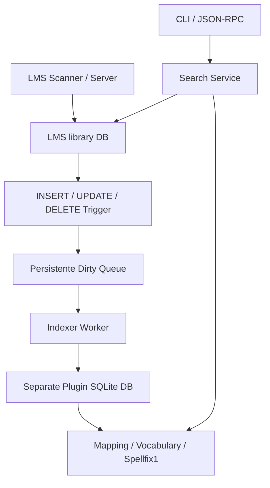

# LMS PhoneticSearch – technische Spezifikation

Version 0.1.0 | Implementierungsentwurf für Codex

## 1. Ziel und Umfang

Eigenständiges Perl-Plugin für Lyrion Music Server (LMS), das lokale Musikbibliotheken mit SQLite spellfix1 fehlertolerant und phonetisch durchsuchen kann. Unterstützt werden Artist, Album, Track und Genre. Keine Cloud, keine Änderungen am LMS-Core als Voraussetzung, keine zusätzlichen Dienste. Bestehende LMS-Suchbefehle bleiben unverändert; eine neue CLI/JSON-RPC-Schnittstelle wird registriert. Optionale Integration in bestehende Suchbefehle erst später, sofern eine dokumentierte Erweiterungsschnittstelle existiert.

Referenzen zur Prüfung durch Codex: https://github.com/LMS-Community/slimserver ; https://www.sqlite.org/spellfix1.html ; https://www.sqlite.org/loadext.html ; https://github.com/sqlite/sqlite/blob/master/ext/misc/spellfix.c . LMS 9.2 ist das zunächst zu prüfende Ziel, keine bestätigte Mindestversion. Vor Implementierung tatsächliche LMS-Versionen, Schemas, Hooks und DBD::SQLite-Methoden anhand des Quellcodes prüfen und Commit-Hashes dokumentieren.

## 2. Architekturentscheidungen

Bevorzugt wird eine separate, jederzeit rekonstruierbare Plugin-Indexdatenbank im LMS-Cachebereich. Die LMS-Bibliotheksdatenbank enthält lediglich eine normale Änderungsqueue und plugin-eigene Trigger. Das isoliert virtuelle Tabellen und ermöglicht dem Scanner, ohne geladene Extension zu schreiben. SQLite-Trigger dürfen nicht direkt in eine andere Datenbank schreiben. Ein Worker liest Änderungen aus der LMS-DB, aktualisiert den separaten Index und bestätigt erst danach die Queue-Einträge. Ein Crash zwischen beiden Commits führt zu idempotenter Wiederholung. Alternative: Index in LMS-DB nur nach explizitem PoC-Nachweis und dokumentierter Entscheidung. Falls bereits normale Trigger die Scanner-Stabilität beeinträchtigen, Trigger entfernen und eventbasierte Reconciliation mit periodischer Prüfung als Fallback anbieten; Abweichung von der Anforderung dokumentieren.



## 3. Repository-Struktur (Vorschlag)

```text
Plugin.pm
Settings.pm
install.xml
strings.txt
lib/{Database,Platform,Spellfix,Indexer,Search,Normalizer,Lifecycle,API}.pm
SQL/{source-install,source-uninstall,index-schema}.sql
HTML/EN/plugins/PhoneticSearch/settings/basic.html
HTML/DE/plugins/PhoneticSearch/settings/basic.html
Bin/<platform>/<library>
Bin/manifest.json
vendor/sqlite/{spellfix.c,sqlite3.h,sqlite3ext.h}
scripts/{build-extension,package,verify-release}
t/{unit,integration,fixtures,poc}
.github/workflows/{ci,release}.yml
docs/{architecture,poc-results,compatibility,operations}.md
```

Pfadkonventionen und Perl-Packages an echte LMS-Plugin-Konventionen anpassen (Plugins::PhoneticSearch::*). Keine unnötigen CPAN-Abhängigkeiten; LMS-Module bevorzugen.

## 4. POCs und Entscheidungs-Gates

| POC | Experiment | Abnahmekriterium |
|---|---|---|
| P0 | LMS-Codeanalyse: DB-Pfade, Schema, Scanner-Prozesse, Lifecycle, Request API, Rechte | Versionierte Matrix und nachvollziehbare Code-Referenzen; keine erfundenen Hooks |
| P1 | Spellfix laden über tatsächliches LMS-DBD::SQLite; in-memory und Datei; Extension danach wieder deaktivieren | Virtual Table anlegen, MATCH-Abfrage erfolgreich, Fehler sauber abgefangen; keine globale dauerhafte Ladefreigabe |
| P2 | Zwei unabhängige Prozesse/Verbindungen, eine ohne Extension; direkte Virtual-Table-Trigger gegen normale Queue-Trigger vergleichen | Queue-Variante erlaubt INSERT/UPDATE/DELETE und Rollback ohne Spellfix; Scanner läuft weiter; direkte Variante nur bei nachgewiesener Sicherheit |
| P3 | Initialscan, inkrementeller Scan, Full Rescan, DB-Ersetzung, Plugin deaktivieren, Neustart, Upgrade und Entfernen | DB-Wechsel erkannt; Trigger und Index rekonstruierbar; Cleanup vor Entfernen der Plugin-Dateien nachgewiesen oder expliziter Vorab-Cleanup dokumentiert |
| P4 | Build und Laden auf Linux x64/ARM64 und mindestens einem Nicht-Linux-Ziel; weitere Targets nach Matrix | Reproduzierbare Artefakte, tatsächlicher LMS-Smoke-Test; ungetestete Plattformen als experimentell markieren |
| P5 | Mehrsprachiger Suchkorpus, kurze Namen, lange Titel, Homonyme, Diakritika, ASR-Fehler | Messbare Top-1/Top-5-Recall, Latenzen und Fehlerfälle; Baseline dokumentiert |
| P6 | Scanner parallel zum Indexaufbau, Kill zwischen Commits, DB busy, fehlende Binary, beschädigter Index | LMS bleibt funktionsfähig; keine verlorenen Änderungen; Wiederanlauf und Rebuild funktionieren |

POCs in isolierter Testbibliothek durchführen, keine produktive DB verwenden. Ergebnisse je POC mit Umgebung, Befehlen, Logs, Status PASS/FAIL/BLOCKED und Architekturentscheidung festhalten. Nach P0–P6 Review-Gate; Codex soll bei einem blockierenden Ergebnis keine nicht belegte LMS-Integration erfinden.

## 5. Datenmodell

Quell-Mapping (zu verifizieren): contributors.id/name → artist; albums.id/title → album; tracks.id/title → track; genres.id/name → genre. Contributor-Rollen prüfen; V1 alle relevanten Musik-Contributors, keine stillschweigende Beschränkung auf Albumartist. Nicht-Musik- und Remote-Einträge anhand tatsächlicher LMS-Semantik filtern. IDs sind nur innerhalb einer Bibliotheksgeneration stabil.

In LMS-DB:

```sql
CREATE TABLE ps_dirty (
  seq INTEGER PRIMARY KEY AUTOINCREMENT,
  entity_type TEXT NOT NULL,
  entity_id INTEGER NOT NULL,
  UNIQUE(entity_type, entity_id)
);
```

In separater Plugin-DB:

```sql
CREATE TABLE ps_meta (key TEXT PRIMARY KEY, value TEXT NOT NULL);
CREATE TABLE ps_vocab (
  id INTEGER PRIMARY KEY,
  entity_type TEXT NOT NULL,
  normalized TEXT NOT NULL,
  UNIQUE(entity_type, normalized)
);
CREATE TABLE ps_entity (
  entity_type TEXT NOT NULL,
  entity_id INTEGER NOT NULL,
  original TEXT NOT NULL,
  vocab_id INTEGER NOT NULL REFERENCES ps_vocab(id),
  PRIMARY KEY(entity_type, entity_id)
);
CREATE INDEX ps_entity_vocab ON ps_entity(vocab_id);
CREATE VIRTUAL TABLE ps_spell_artist USING spellfix1;
CREATE VIRTUAL TABLE ps_spell_album USING spellfix1;
CREATE VIRTUAL TABLE ps_spell_track USING spellfix1;
CREATE VIRTUAL TABLE ps_spell_genre USING spellfix1;
```

Vier virtuelle Tabellen sind hier bewusst gewählt: Ein gemeinsames Vocabulary kann bei typgefilterten Top-K-Abfragen relevante Treffer verdrängen. Deduplication innerhalb eines Typs bleibt bestehen. Alternativ gemeinsame Tabelle mit typbezogener Partitionierung (langid) nur nach Benchmark. Spellfix-rowid entspricht ps_vocab.id; rank zunächst konstant, langid=0. Keine manuell gepflegten Referenzzähler in V1; unreferenzierte Vocabulary-Zeilen via NOT EXISTS entfernen, samt Spellfix-Zeile. Alle Änderungen an Mapping/Vocabulary/Spellfix innerhalb einer Indextransaktion. Schema- und Normalisierungsversion in ps_meta speichern. Fremdschlüssel auf Plugin-Verbindungen aktivieren.

## 6. Trigger und inkrementelle Synchronisation

Zwölf AFTER-Trigger (INSERT/UPDATE/DELETE je Quelltabelle). UPDATE auf relevante Namensfelder und ggf. IDs/Filterattribute beschränken. Bei ID-Wechsel alte und neue ID markieren. Queue speichert Dirty-IDs, keine historischen Namen oder Operationen; Worker liest den aktuellen Zustand. Beispiel (Schema erst nach P0 verbindlich):

```sql
CREATE TRIGGER ps_tracks_ai AFTER INSERT ON tracks BEGIN
  INSERT OR REPLACE INTO ps_dirty(entity_type,entity_id)
  VALUES ('track',NEW.id);
END;
CREATE TRIGGER ps_tracks_au AFTER UPDATE OF title,id ON tracks BEGIN
  INSERT OR REPLACE INTO ps_dirty(entity_type,entity_id)
  VALUES ('track',OLD.id);
  INSERT OR REPLACE INTO ps_dirty(entity_type,entity_id)
  VALUES ('track',NEW.id);
END;
CREATE TRIGGER ps_tracks_ad AFTER DELETE ON tracks BEGIN
  INSERT OR REPLACE INTO ps_dirty(entity_type,entity_id)
  VALUES ('track',OLD.id);
END;
```

Worker erfasst Batch aus seq/type/id plus jeweiligem aktuellem Quellzustand in einer konsistenten Lesetransaktion. Commit im Index. Erst danach Queue mit WHERE seq=? bestätigen; neuere Änderungen besitzen neue seq und bleiben erhalten. Nur ein aktiver Writer; kein paralleler Rebuild und Update-Worker. Bei DB-Generationswechsel keine alten Batches bestätigen. Busy-Timeout und begrenzter Backoff, kurze Transaktionen; Queue- und Indexfehler sichtbar melden. Keine externen Funktionen in Triggern. SQLite REPLACE-Semantik, Bulk-Operationen und mögliche fehlende DELETE-Trigger bei REPLACE im POC testen; periodische Reconciliation deckt verpasste Ereignisse ab.

## 7. Initialindex und Rebuild

Trigger vor Snapshot installieren, während Rebuild Queue weiter anwachsen lassen. Initialbestand aus konsistentem Snapshot lesen; bei großen Bibliotheken Snapshot-Lock/WAL-Wachstum messen und gegebenenfalls optimistisches Batch-Verfahren mit vollständiger Reconciliation nutzen. Staging-Index erstellen, danach Dirty-Queue replayen, Integrität und Generation prüfen, auf neuen Index umschalten. Keine Queue-Einträge bestätigen, solange nur ein nicht aktiver Staging-Index aktualisiert wurde. Bei Aktivierung und Cleanup Crash-konsistente Zustandsmarker verwenden. Bei Windows offene Handles vor Dateiumbenennung schließen. Alte Indexgeneration erst nach erfolgreichem Umschalten entfernen. Änderungen, die während der Aktivierung eintreffen, anschließend verarbeiten. Suchergebnisse während Rebuild aus altem Index nur bei identischer Quellgeneration; andernfalls status=building/index_not_ready. LMS synchronen Eventloop nicht blockieren: kleine zeitbudgetierte Batches oder separater Worker nach POC, keine Perl-Thread-Annahme.

## 8. Extension- und Plattformmanagement

Pinned SQLite-Upstream-Revision mit spellfix.c und passenden Headern, Prüfsumme, Lizenzhinweisen und Herkunft. Extension über sqlite3ext.h/SQLite Extension API bauen; nicht gegen ein zweites libsqlite3 linken. Linux beispielhaft `cc -O2 -fPIC -shared spellfix.c -o spellfix.so`; macOS `cc -O2 -fPIC -dynamiclib spellfix.c -o spellfix.dylib`; Windows passende DLL-Export-/Compileroptionen im CI verifizieren. Entry point sqlite3_spellfix_init explizit nutzen, sofern DBI-Schnittstelle dies unterstützt. Tatsächliche API-Fähigkeit per POC feststellen, nicht allein Versionsnummern vertrauen.

Beim Start: OS, Prozessarchitektur/Bits, CPU-Baseline, Linux libc/ABI erkennen; Manifest abgleichen; lokale Datei und SHA-256 validieren; nur absolute vertrauenswürdige Pfade aus Plugin-/Build-Cache laden. Extension-Loading nur kurz auf dediziertem DB-Handle aktivieren, auch bei Fehler deaktivieren. Keine Pfade aus API-Requests. Für jedes neue Index-DB-Handle Extension laden. Laden mit temporärer Virtual Table und MATCH testen. Kein globales Auto-Extension-Registrieren. Fehler bedeutet deaktivierte Plugin-Suche, nicht LMS-Ausfall. Native Binaries sind vertrauenswürdiger Code; Prüfsummen schützen primär vor Beschädigung, nicht vor kompromittiertem Release.

Fallback: ausschließlich mit expliziter Admin-Freigabe lokal bauen; Compiler und Headers prüfen, Argumentlisten statt Shell-Interpolation, keine Paketinstallation, kein sudo, kein ungefragter Netzwerkzugriff. Versionierten beschreibbaren Cache verwenden. Log und Build-Timeout. Bei Fehlschlag klare Diagnostik.

## 9. GitHub Actions und Release

| Ziel | Architektur/ABI | Priorität |
|---|---|---|
| Linux | x86_64 glibc | P1 |
| Linux | aarch64 glibc | P1 |
| Linux | armv7 hard-float glibc | P1 |
| Windows | x86_64 | P1 |
| macOS | x86_64 | P1 |
| macOS | arm64 | P1 |
| Linux | armv6 hard-float, musl x86_64/aarch64 | P2, nach Bedarf |
| Weitere | FreeBSD/NAS-Sondervarianten/32-bit Windows | P3 |

P1 bezeichnet angestrebten Releaseumfang, nicht bereits getestete Unterstützung. Linux auf möglichst alter unterstützter glibc-Baseline bauen, CPU-Flags konservativ, Cross-Compiler für ARM; native oder emulierte Tests plus echte LMS-Runtime-Tests, ggf. separate self-hosted Runner. macOS Deployment Target und Windows Runtime-Abhängigkeiten dokumentieren. Keine System-SQLite-Tests als alleinigen LMS-Kompatibilitätsnachweis.

CI bei PR: Perl-Tests, SQL-Integration, Build-Matrix, Binary-Smoke-Tests, Suchkorpus. Release bei versioniertem Tag: Build-Matrix → einzelne Artefakte → Manifest (OS, arch, ABI/libc, min OS, SQLite-Revision, SHA-256, Build-Revision, Teststatus) → Paketierung → ZIP-Installations-Smoke-Test → GitHub Release. Alle P1-Binaries direkt im einzigen Plugin-ZIP enthalten, keine Downloads beim normalen Start. Fehlende Pflichtartefakte blockieren Release; Änderungen der Pflichtmatrix explizit dokumentieren. LMS-Repository-XML für Plugin-Manager bereitstellen, Format und erforderliche Prüfsumme gegen LMS prüfen. GitHub Actions minimale Permissions, gepinnte Actions, keine Release-Secrets in PR-Jobs. Optional SBOM, Provenance und Signatur. ZIP-Struktur und install.xml Version konsistent prüfen.

## 10. Suche und Normalisierung

V1: Unicode-NFC/NFKC nach fachlichem Test, Unicode casefold, trim, Whitespace vereinheitlichen, definierte Interpunktion behandeln; Original erhalten. Diakritika-/Umlautvarianten, AC/DC, P!nk, The Beatles und kurze Titel im Korpus prüfen. Bei aggressiver Normalisierung Kollisionen erhalten und alle zugehörigen Entitäten zurückgeben. Index und Anfrage identisch normalisieren. Spellfix-Transliteration und phonetische Hash-Heuristik ersetzen keine sprachspezifische ASR-Korrektur. Keine Garantie für Justin Bieber / Dschastin Biber. V1 langid=0, keine automatische Sprachzuordnung. V2 optionale Aliase, soundslike, editdist3-Kostentabellen für DE/EN und Token-/Teilwortindex für lange Titel. Keine künstliche Trefferwahrscheinlichkeit aus distance ableiten.

Suchpipeline: exakter Originaltreffer → normalisierter exakter Treffer → optional Präfix → Spellfix MATCH je gewünschtem Typ → Entity-Mapping → Live-Validierung gegen LMS-DB → deduplizieren → deterministisch ranken → paginieren. Spellfix scope/top begrenzen und empirisch tunen; filter distance nach Kandidatengenerierung; Ranking mit Matchklasse, normalisierter Distanz, Spellfix-Score, Typkontext und stabiler ID. Kleine Scores von Spellfix sind besser; eigener Score getrennt dokumentieren. Für 1–2 Zeichen standardmäßig nur exact/prefix. Mehrdeutige Treffer nicht automatisch abspielen. Teilwort- und feldübergreifende Suche nicht als V1-Vollfunktion versprechen.

## 11. CLI/JSON-RPC API (Vertrag, Registrierung im POC prüfen)

```text
phoneticsearch 0 20 query:bitels type:artist
phoneticsearch 0 20 query:ramstein type:artist,track
phoneticsearch status ?
phoneticsearch index status ?
phoneticsearch index rebuild
phoneticsearch index verify
phoneticsearch index cleanup
```

JSON-RPC Beispiel an `/jsonrpc.js`:

```json
{"id":1,"method":"slim.request","params":["",["phoneticsearch",0,20,"query:bitels","type:artist"]]}
```

Result-Payload (innerhalb des üblichen LMS-RPC-Envelopes, illustrative Werte):

```json
{"count":1,"offset":0,"limit":20,"total_is_exact":false,"index_state":"ready","results_loop":[{"type":"artist","id":4711,"name":"The Beatles","match_type":"phonetic","distance":35,"spellfix_score":40,"score":0.82}]}
```

count = Anzahl der gefundenen, deduplizierten begrenzten Kandidaten vor Pagination; total_is_exact=false bei truncation oder approximativer Suche. Ergebnisse für identische Parameter deterministisch bei unverändertem Bestand. Parameter query (max 256 Unicode-Zeichen), type (Whitelist, default alle), offset (>=0), limit (default 20, max 100), maxdistance optional (validierter Bereich anhand PoC), mode exact/auto/phonetic (default auto). Kandidaten- und Offset-Obergrenzen definieren, keine unbeschränkten Scans. score eigener Rankingwert, keine Wahrscheinlichkeit. Optional artist_id/album_id als spätere Kontextfilter. Fehler: invalid_parameter, unsupported_platform, extension_unavailable, index_not_ready, index_busy, internal_error. Native LMS-Status-/Fehlerkonventionen verwenden. Administrative Befehle nur über nachweislich berechtigte Admin-Oberfläche oder abgesicherte lokale Schnittstelle; wenn LMS keine verlässliche Autorisierung bietet, keine destruktiven Remote-Kommandos registrieren. SQL vollständig parametrisieren; Identifier über statische Whitelist. Keine neue öffentliche HTTP-Schnittstelle.

## 12. Lifecycle und Administration

Zustände: disabled, initializing, extension_unavailable, building, ready, updating, stale, error, cleanup_pending. Start: Kompatibilitätsprüfung, Extension laden, DB-Generation und Schema prüfen, fehlende Trigger installieren, Index erstellen/migrieren, Queue abarbeiten, API/Status verfügbar machen. Scan-Events anhand tatsächlicher LMS-Hooks abonnieren; nach Scan Generation, Tabellenschema, Trigger und Index prüfen. DB-Dateiidentität plus verfügbare LMS-Generationsmarker prüfen; Ersetzungen und In-place-Rebuilds berücksichtigen. Bei unklarer Generation konservativ Rebuild. Periodische Reconciliation zusätzlich. Plugin deaktiviert: Worker/Timer stoppen, Trigger und Queue entfernen, Index behalten aber als stale markieren; bei Reaktivierung Abgleich/Rebuild. Verhindert unbegrenztes Queue-Wachstum. Shutdown nicht mit Deinstallation gleichsetzen.

Deinstallation: Worker stoppen, Handles synchronisieren, alle eigenen Quelltrigger zuerst löschen, dann Queue; eigene Indexdatei samt zugehörigen Nebenfiles nach Schließen der Connections, Build-Cache und Einstellungen gemäß definierter Policy löschen. Native Extension endet mit dem Handle/Prozess, keine erzwungene DLL-Entladung. Niemals LMS-Originaltabellen verändern/löschen. Idempotent, Fehler sichtbar und Wiederholung möglich. Wenn LMS-Plugin-Manager keinen verlässlichen Pre-Uninstall-Hook besitzt, Admin-Aktion „Plugin-Daten vollständig entfernen“ vor Deinstallation und unabhängige Recovery-SQL/Anleitung bereitstellen. Automatische Deinstallation erst als erfüllt markieren, wenn P3 dies nachweist. Keine Cleanup-Logik auf jedem Server-Shutdown.

Settings DE/EN: Indexstatus, Binary/ABI/SQLite-Version, Anzahl je Typ, Queue-Größe, letzte Aktualisierung, Rebuild/Verify, Cleanup mit Bestätigung, optional Build-Fallback. Logs via LMS-Logging ohne vollständige Musikbibliothek standardmäßig auszuschreiben. Rebuild asynchron mit Fortschritt; kein persistenter Timer nach Disable.

## 13. Tests und Abnahmekriterien

Unit: Normalisierung, Unicode, Parameter, Plattformwahl, Manifest, Ranking. Integration: echte SQLite-Extension, vier Entitätstypen, identische Namen, NULL/leer, Insert/Update/Delete, ID-Wechsel, rollback, REPLACE, konkurrierende Updates, Crash vor/nach Indexcommit, Rebuild bei aktiven Änderungen, Full Scan, Disable/Enable, Upgrade, Cleanup zweimal, fehlende/inkompatible Binary, beschädigter Index, Busy/Readonly, SQL-Injection. LMS-Systemtest mit Server und separatem Scanner sowie CLI/RPC-Requests. Keine ausgelassenen Testfälle stillschweigend als bestanden markieren.

Suchkorpus: Beatles/Bitels/Bietels, Pink Floyd/Pink Floid, Rihanna/Riana, Justin Bieber/Dschastin Biber, Beyoncé/Beyonce, Rammstein/Ramstein, AC/DC/ACDC, P!nk/Pink, Die Ärzte/Die Aerzte, Queen sowie gleichnamige Tracks/Alben. Erwartete Top-1/Top-5 und Negativfälle versionieren; DE/EN-ASR-Fehler separat berichten. Vorläufige Zielwerte (nach P5 zu bestätigen): Top-5 >=90% für kuratierten Tippfehlerkorpus, keine fixe ASR-Garantie; exakte Treffer immer vor fuzzy; p95 <=250 ms für warme Suche auf dokumentierter x86_64-Referenz mit 100k Tracks, ARM separat messen; Indexänderungen im Normalbetrieb innerhalb 5 s, außer während Scans/Busy. Keine ungeprüfte SLA. Benchmark 10k/100k/500k Tracks, Aufbauzeit, Speicher, Queue-Latenz, DB-Größe, Scanner-Overhead. Produktionsfreigabe nur wenn kein LMS-Scan durch Pluginfehler scheitert und abgeschlossene Änderungen nach Wiederanlauf vollständig reconciled sind.

## 14. Phasenplan

| Phase | Inhalt | Ergebnis / Gate |
|---|---|---|
| 0 | P0 Quellcodeanalyse, Testumgebung, Repo-Grundgerüst | Kompatibilitätsmatrix, dokumentierte Hooks |
| 1 | P1–P6, erste CI-Builds | PoC-Bericht und Architekturfreigabe; keine Produktivinstallation |
| 2 | Plugin-Lifecycle, Loader, Plattformmanifest, Fehlerbehandlung | Extension auf geprüften Plattformen nutzbar |
| 3 | SQL-Schema, Trigger, Queue, Indexer, Crash-Recovery, Rebuild | Konsistenter Index für alle vier Typen |
| 4 | Normalizer, Suche, Ranking, CLI/JSON-RPC | End-to-End-Suche, Korpustests |
| 5 | Settings DE/EN, Scan-Integration, Cleanup, Upgrade | Vollständiger Lifecycle getestet |
| 6 | Vollständige GitHub Actions Matrix, Paketierung, LMS-Repo-XML, Systemtests | Installierbares Release-ZIP mit Binaries |
| 7 | Pilot, Benchmarks, Fehlerkorrektur, Dokumentation | V1-Freigabe nach Abnahmekriterien |
| 8 | Optional: Aliase, DE/EN-Regeln, Token-/kombinierte Suche, bestehende LMS-Suche integrieren | Separate V2-Spezifikation |

Nach jeder Phase Tests ausführen, Ergebnisse und offene Risiken in docs/progress.md erfassen, atomare Commits, keine unaufgeforderten Releases oder Installationen. Build-Pipeline bereits in Phase 1 beginnen, nicht erst zum Release.

## 15. Offene Entscheidungen und Risiken

Hoch: LMS-DBD::SQLite Extension-Loading eventuell nicht verfügbar; dann kompatibler separater SQLite-Worker nur nach neuer Architekturentscheidung, keine LMS-Core-Patches ohne Freigabe. Trigger können bei DB-Schemaänderungen oder Fehlern Quellwrites blockieren; fail-safe Cleanup und Stresstest zwingend. Deinstallationshook nicht bestätigt. Scanner kann DB ersetzen oder in-place neu befüllen. ARM/libc/Windows/macOS Kompatibilität erst per Tests bestätigt. Sprachqualität insbesondere ASR nicht voraussetzen. Index außerhalb LMS-DB und vier Spellfix-Tabellen sind begründete Entwurfsentscheidungen, keine vorab bestätigten Nutzerentscheidungen. POC-Gate kann sie ändern. Kein bereits ausgeführter POC und keine Live-Verifikation in dieser Spezifikation.

## 16. Startprompt für Codex

Lies diese Spezifikation vollständig. Prüfe zuerst Repository und relevante LMS-Quellcodes für die Zielversion, dokumentiere tatsächliche Schemas, Scanner-Prozesse, APIs und Plugin-Lifecycle. Implementiere nur Phase 0 und danach die isolierten POCs P1–P6 mit reproduzierbaren Tests und erster GitHub-Actions-Build-Matrix. Verwende keine produktive LMS-Datenbank. Dokumentiere reale Ergebnisse, Abweichungen, Risiken und nicht testbare Plattformen in docs/poc-results.md und docs/compatibility.md. Keine erfundenen Testergebnisse, keine Änderungen am LMS-Core, keine Releases oder produktiven Installationen. Stoppe nach dem POC-Gate und präsentiere die empfohlene endgültige Architektur sowie offene Entscheidungen, bevor du Phase 2 beginnst. Lege für spätere Sitzungen docs/progress.md mit Status, Testbefehlen und nächsten Schritten an.
